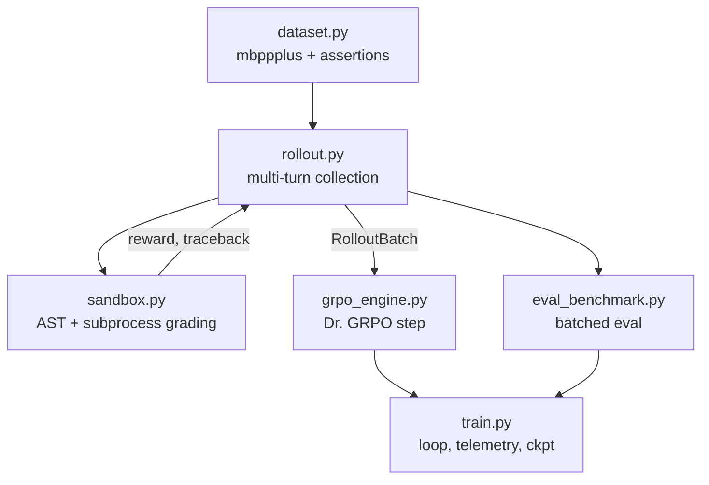
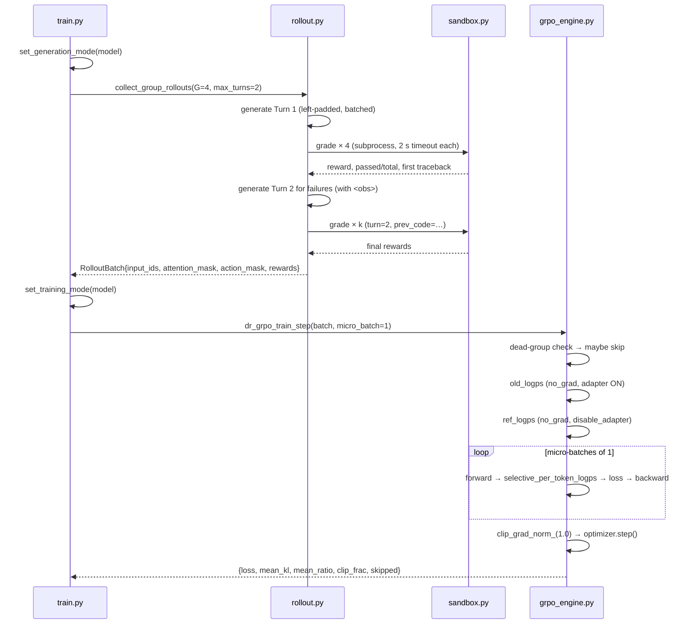

# Architecture notes

Deeper detail for the parts that are easy to hand-wave in a README: tensor shapes, the exact
sequence of model calls in a training step, and where the VRAM actually goes.

---

## 1. Module graph



Dependency direction is strictly one-way: `train` → `eval_benchmark` → `rollout` → `sandbox` → `dataset`.
`grpo_engine` depends on `rollout` only for the `RolloutBatch` type, so the engine can be unit-tested
with a plain dict.

---

## 2. One training step, call by call



Order matters: `old_logps` **must** be computed with the adapter enabled and `ref_logps` with it
disabled, both before any optimizer step, otherwise the ratio `π_θ / π_old` is silently ≠ 1 at step
start and the first update is biased.

---

## 3. Shapes through the pipeline

| Stage | Tensor | Shape | Notes |
|---|---|---|---|
| Prompt (Turn 1) | `prompt_ids` | `(G, P)` | left-padded |
| Generation | `gen_out` | `(G, P + N)` | KV cache on |
| Trajectory | `input_ids` | `(G, L)` | right-padded, `L = P + N₁ + O + N₂` |
| | `action_mask` | `(G, L)` | 1 on policy tokens only |
| Forward | `logits` | `(G, L−1, V)` | `V = 248320`, causal shift |
| Per-token | `per_token_logps` | `(G, L−1)` | row-wise log-softmax + gather |
| Objective | `ratio`, `kl` | `(G, L−1)` | masked by `action_mask[:, 1:]` |
| Loss | `seq_loss` | `(G,)` | `−Σ_t obj_t / 768` |

The `(G, L−1, V)` logits tensor is unavoidable (the LM head produces it), but the **fp32 copy** is
not: `selective_per_token_logps` upcasts one row at a time, so the fp32 transient is
`(L−1) × V × 4` for a single sequence rather than for the whole group, and it is created under
`no_grad` so it is freed before the next row is touched.

```python
for logit_row, target_row in zip(logits, targets):          # (L-1, V), (L-1,)
    log_probs = F.log_softmax(logit_row.float(), dim=-1)    # fp32 for one sequence only
    row = log_probs.gather(-1, target_row.unsqueeze(-1)).squeeze(-1)
```

Concretely at `V = 248,320` and `L = 1536`: one row costs ~1.5 GB as fp32 (upcast + softmax output,
~3 GB peak), which is affordable once. Doing the same for `B = 4` at once costs ~12 GB and fails on
a 16 GB card that is already holding quantised weights, a KV cache, and activations.

---

## 4. Where the mask comes from

`rollout.py` builds `action_mask` incrementally, never by string matching after the fact:

1. Turn-1 prompt tokens → `[0] * P`.
2. Turn-1 generated tokens (EOS included, pads trimmed) → `[1] * N₁`.
3. Turn-2 suffix, built by rendering the chat template with an assistant placeholder and slicing
   *after* it → `[0] * O`. This covers `<|im_end|>`, the new user turn, `<obs>…</obs>`, the repair
   instruction, and the assistant ` thinking\n` prefill in one go.
4. Turn-2 generated tokens → `[1] * N₂`.
5. Right-padding to `max(L)` → `[0] * (max_L − L)`.

The invariant tested in `verify_phase2.py` is stronger than "prompt is masked": it decodes the
contiguous `mask == 1` spans and asserts they equal the Turn-1 and Turn-2 completion strings exactly,
and that the `mask == 0` gap between them contains both `<obs>` tags.

---

## 5. Reward arithmetic

```
r = 0.15                          # format gate passed
  + 0.75 · (passed / total)       # continuous partial credit
  + 0.10 · [turn == 1 ∧ all pass] # one-shot bonus
  − 0.10 · [turn == 2 ∧ code identical to turn 1]
r = clamp(r, 0, 1)
```

Consequences worth noting:

- A Turn-1 success scores `1.00`; a Turn-2 self-heal scores at most `0.90`. The model is paid to be
  right the first time, and paid less to be right only after being told what broke.
- A format-only failure scores `0.15` and is *not* zero, so the policy still receives a gradient
  signal distinguishing "rambled, no patch" from "crashed immediately". The dead-group check then
  removes groups where all four rollouts scored identically.
- The duplicate penalty is applied *after* the completion bonus, so a lazy Turn-2 that resubmits
  identical code cannot bank `0.15 + 0.75 + 0.10` twice.

---

## 6. Failure modes the harness deliberately handles

| Failure | Detection | Behaviour |
|---|---|---|
| No `</think>`, truncated mid-thought | `parse_completion` finds no think block | reward `0.0`, `<obs>` explains the format error |
| Code block but syntax error | `ast.parse` raises | `SyntaxError` in `<obs>`, no subprocess spawned |
| Forbidden import/call | AST walk | `SecurityError` in `<obs>`, no subprocess spawned |
| Infinite loop / very slow case | `subprocess.run(timeout=2.0)` | killed, `TimeoutError` in `<obs>`, partial credit preserved as 0 |
| Runtime error in one assertion | per-assertion `try/except` | that assertion fails, the remaining ones still run |
| All rollouts identical reward | `max(r) − min(r) < 1e-5` | step skipped, `dead_group_ratio` incremented |
| Turn-2 resubmits Turn-1 code | string equality on extracted code | `−0.10`, flagged `duplicate_code_penalty_applied` |

The per-assertion `try/except` is why a single `NameError` costs 1/107 of the reward instead of
collapsing the whole rollout to zero — which matters early in training, when nearly every rollout is
partially broken.

---

## 7. Checkpoint format

```
checkpoints/step_050/
├── adapter_config.json     # PEFT config (r=16, α=32, 7 target modules)
├── adapter_model.safetensors
├── optimizer.pt            # PagedAdamW8bit state
├── scheduler.pt            # cosine schedule position
└── trainer_state.json      # {step, dead_groups, total_groups, seed}
```

`--resume-from checkpoints/step_050` restores weights via `set_peft_model_state_dict`, then the
optimizer and scheduler, and continues at `step + 1`. The JSONL log is *appended*, not truncated, so
a resumed run leaves one continuous `train_metrics.jsonl`.

---

## 8. Telemetry schema

`logs/train_metrics.jsonl`, one object per step:

```json
{"step": 1, "task_id": 410, "loss": -0.0012, "mean_reward": 0.5125,
 "turn1_pass": 0.25, "turn2_pass": 0.75, "dead_group_skipped": false,
 "dead_group_ratio": 0.0, "mean_kl": 0.00031, "mean_ratio": 1.0,
 "avg_think_tokens": 143.2, "format_compliance": 1.0, "lr": 4.9e-06,
 "step_time_sec": 38.4, "peak_vram_gb": 10.7}
```

`mean_kl` and `mean_ratio` are masked means, so they are not diluted by prompt/pad tokens. A rising
`mean_ratio` with a flat `mean_reward` is the signal to lower `lr`; a `dead_group_ratio` above ~0.6
means the current problems are too easy and the curriculum should shift.
